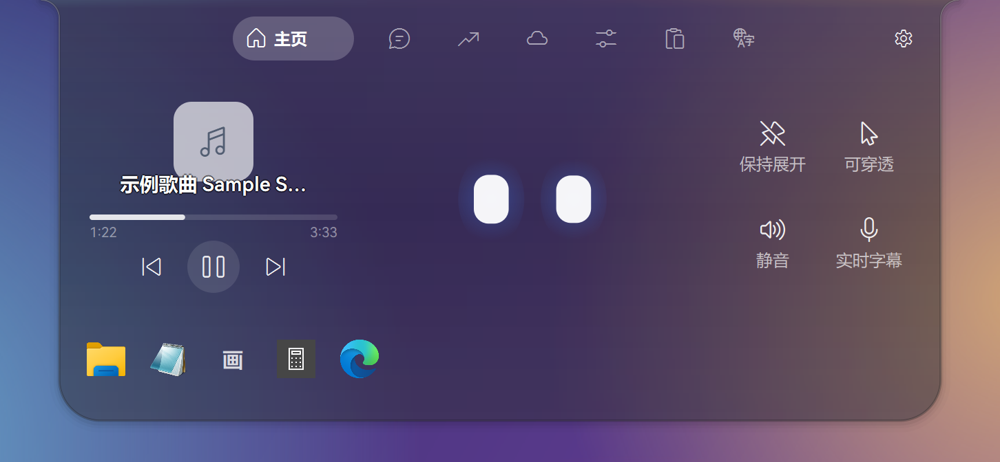

# dsh-island

> **DSH 适配层** — 为 [wisland](https://github.com/AsamiAkito/wisland) 桌面灵动岛添加 DeepSeek Harness（DSH）状态接入。

> **⚠️ 重要：灵动岛（wisland）不是本项目创作。** 它的液态外观、小形象、交互、天气/音乐等功能全部来自 [AsamiAkito/wisland](https://github.com/AsamiAkito/wisland)（MIT 协议）。本仓库**只做了一件事：DSH 适配**——让灵动岛的眼睛颜色和律动条颜色反映 DSH 状态。喜欢这个灵动岛请给原作者点 Star 🙏。



wisland 是一个 Windows 液态灵动岛（Python + PySide6），贴在屏幕边缘、悬停展开。本仓库在它基础上接入了 DSH：**不用盯着 DSH 窗口，扫一眼灵动岛就知道它在干什么**。

## DSH 状态 → 颜色（常驻）

灵动岛的小形象眼睛颜色、以及音乐视图的四条律动条，会**常驻**反映 DSH 当前状态：

| DSH 状态 | 颜色 | 含义 |
|---|---|---|
| 干活中 | 蓝 | 正在执行任务 |
| 等你授权 / 等你回答 | 琥珀 | 需要你介入 |
| 完成 | 绿 | 这一轮做完了 |
| 出错 | 红 | 出问题了 |
| 空闲 | 默认色 | 没事 |

- **空闲时**看小形象的眼睛颜色
- **听歌 / 看视频时**看四条律动条的颜色
- 两者用同一套颜色，走到哪都能扫一眼状态

## 它解决什么问题

DSH 本身只有窗口内的进度提示：窗口一最小化、或你切去打游戏看视频，就不知道它是在干活、等你授权、还是已经做完了。dsh-island 把状态搬到桌面的灵动岛上，而且用**颜色常驻**表达（不是弹一下就消失的提示），余光一瞥即知。

## 安装

### 1. 安装 wisland

1. 安装 **Python 3.10 或更新版本**（安装时勾选 Add python.exe to PATH）
2. 下载本仓库并解压，或 `git clone`
3. 双击 **`setup.bat`**（自动创建 .venv、安装依赖）
4. 双击 **`wisland.vbs`** 启动

### 2. 安装 DSH 接入插件

把 `dsh-wisland/` 目录装进你的 DSH profile（在插件页「添加插件」选本地目录，或用 `dsh plugin add <dsh-wisland 路径>`）。

插件会监听 DSH 的会话 / 授权 / 提问事件，把状态写进 `%USERPROFILE%\.dsh\desktop-capsule\status.json`；wisland 每 1.5 秒读取一次并更新颜色。

> 注意：DSH 的「授权 / 提问」事件是**会话作用域**的，插件已按正确方式（在 agent 作用域上注册）监听，无需额外配置。

## 实时字幕（日语 → 中文）

在灵动岛上点「开始聆听」，播放日语视频 / 音频时会实时出**日语字幕 + 中文翻译**：

- **日语识别**：本地 Parakeet 0.6B（sherpa-onnx），不联网、不上传音频
- **中文翻译**：默认使用 **B 站 Index-Translate** 免费接口（无需 Key、无需注册）

### 启用步骤

1. 装依赖（`setup.bat` 已包含）：
   ```bash
   pip install numpy SoundCard soxr sherpa-onnx huggingface-hub
   ```
2. 下载日语模型（约 625 MB，国内建议走镜像）：
   ```bash
   set HF_ENDPOINT=https://hf-mirror.com
   python scripts/download_models.py
   ```
3. 启动 wisland → 灵动岛「实时字幕 → 开始聆听」

### 翻译服务（`config.json → translate`）

| 服务 | 费用 | 是否需要 Key | 配置 |
|---|---|---|---|
| **B 站 Index-Translate**（默认） | 免费 | 不需要 | `base_url: https://index-translate.bilibili.com/v1`、`model: Index-Translate-35B-A3B`、`api_key: free` |
| 智谱 GLM-4-Flash | 免费 | 需要注册 | `base_url: https://open.bigmodel.cn/api/paas/v4`、`model: glm-4-flash` |
| DeepSeek | 便宜但收费 | 需要 | `base_url: https://api.deepseek.com`、`model: deepseek-flash` |

> 翻译走 OpenAI 兼容接口，任何兼容的服务都能接。B 站接口需要浏览器请求头（已内置）。

## 说明

- 基于 [wisland](https://github.com/AsamiAkito/wisland)（MIT）修改，保留原作者版权。
- `models/`（语音识别模型，约 90 MB）与 `data/`、`config.json` 为运行时数据，**不随仓库分发**。
- 天气使用国内可直连的腾讯天气接口；股票功能已移除。

## 许可证

MIT — 见 [LICENSE](LICENSE)。基于 [wisland](https://github.com/AsamiAkito/wisland)（MIT）。
